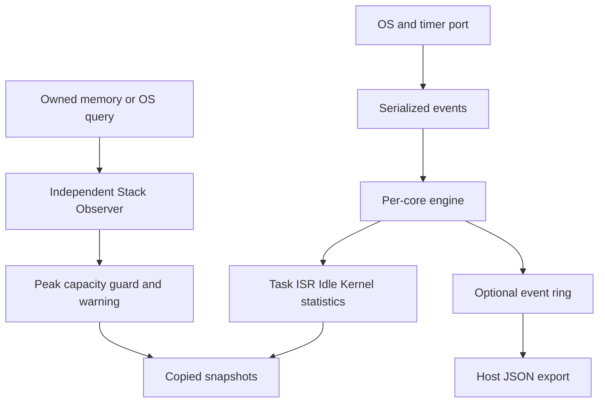

# embedded-runtime-observer

A small, caller-owned C99 toolkit for per-core execution time and historical stack usage.
The time engine and Stack Observer run independently, without an RTOS, MCU SDK or heap.
[中文](README_zh-CN.md)

The time engine assigns each interval to Task, Idle, ISR or Kernel, preserves nested execution
contexts, and closes fixed windows through periodic polls and transitions. Stack Observer adds
effective capacity, observed peak, remaining headroom, warnings and optional boundary guards.



## Run in a minute

Requires a C99 compiler, GNU Make, Python 3, and pthreads for the concurrency test (Linux/Unix host).
The MCU core itself has no pthread/POSIX dependency.

```sh
git clone https://github.com/binkyle/autosar-module-lab.git
cd autosar-module-lab/embedded-runtime-observer
make test
./build/benchmark
./build/stack_simulator
```

`basic` prints `Task=20 Idle=70 ISR=10 Total=100 Load=30.0%`.
The suite passes **37 contract scenarios**, **4 Python tool tests**, 100,000 randomized transitions
against an independent tick oracle, two simulated cores with two concurrent snapshot readers,
and five time examples. Stack Observer adds **39 contract scenarios**, 8,000 byte-oracle
operations, 200,000 serialized concurrent operations and two examples.
See [time validation](docs/validation.md) and [stack validation](docs/validation/stack-validation.md).

An equivalent CMake configuration is provided for CI and development:

```sh
cmake -S . -B build-cmake -DRTM_SANITIZE=ON
cmake --build build-cmake --parallel
ctest --test-dir build-cmake --output-on-failure
```

Build only Stack Observer, or retain the original time-only configuration:

```sh
cmake -S . -B build-stack -DRTM_BUILD_RUNTIME=OFF
cmake --build build-stack --parallel
ctest --test-dir build-stack --output-on-failure
make stack-test                 # Host stack tests and examples only
make RTM_BUILD_STACK=0 test      # Original time engine only
make stack-benchmark
```

For a library-only target build, also set `-DBUILD_TESTING=OFF -DRTM_BUILD_EXAMPLES=OFF`.
The `rtm_stack` library has no Trace, time-engine, pthread or POSIX dependency.

## Smallest example

```c
#include "rtm/rtm.h"
static rtm_core_t core;
rtm_config_t config = {100, 100, 0, 32, 1}; /* ticks; core; bits; mock coverage */
rtm_snapshot_t result;

/* Check every status in an actual integration. This single-thread mock has
   no concurrent writers. Target code uses a critical-section port. */
rtm_init(&core, &config, 0, RTM_IDLE);
rtm_isr_enter(&core, 20, 0);
rtm_isr_exit(&core, 30, 0);
rtm_snapshot(&core, 100, &result); /* exact 100-tick boundary, still in Idle */
/* result.last_window: Idle=90, ISR=10, CPU Load=10%. */
```

## What the numbers mean

`Total = Idle + Task + ISR + Kernel`, and `Busy = Total - Idle`. IRQ exclusive time excludes
nested IRQs; inclusive time includes them. Function points report same-owner CPU time, excluding
preemption/blocking. Their totals overlap CPU categories. Counts/min/max/averages are for completed
dispatch intervals or invocations, not inferred task activations. Snapshots also include open
execution time. See [contracts](docs/architecture/contracts.md) before using hardware results.

Every access to one object must be serialized, including snapshot and trace reads. The port wrapper
masks writers **before** reading time. All windows require polling within `max_gap_ticks`, which is
below timer half-range and no longer than a window. Missing whole wraps cannot be inferred from a
low-counter sample. A 64-bit window can span multiple low-32 wraps when sampling is timely.

## Scope and footprint

| Capability | v0.2.0 |
|---|---|
| Portable online engine, nested IRQs/functions, fixed windows | Host verified |
| Same-object concurrent access | Caller serialization; mutex simulation tested with ThreadSanitizer |
| Bare metal and AUTOSAR | Explicit interfaces and runnable mocks |
| TC397 / MICROSAR / TASKING | **Experimental / Unverified**; no vendor build/hardware results |
| Trace | Optional bounded FIFO; explicit drops; Host CSV→Perfetto instant-event JSON |
| Stack painting / watermark / peak / guard | Independent C99 library; down/up growth; 1/2/4/8-byte cells; Host verified |
| OS stack observation | Authorized query callback; unit normalization; AUTOSAR mock verified |
| Current SP usage / CSA observation | Unsupported / future separate module |
| CTF / BTF / globally synchronized multicore snapshots | Not implemented |
| Task migration, inferred activations, automatic WCET certification | Not implemented |

Default host layout: **11,144 bytes/core**, 3,648 bytes/snapshot. Reducing Tasks/ISRs/Points to 8,
depth to 4, and Trace to 0 gives **3,504 bytes/core**. Configure the same macros in every translation
unit. No hook allocates, blocks, transports, or prints; cost is bounded by compiled nesting limits.
Host sizes/timings do not establish TC397 RAM/ROM/WCET. Incomplete ISR coverage produces an observed
load estimate, even if the accounting equation holds perfectly.

## Stack Measurement

An application-owned, offline region can be painted and scanned from its deepest usable end.
The first changed cell defines an observed high-water mark; later measurements retain the maximum
within that paint epoch. Effective capacity excludes both reserves and the optional guard.
Remaining capacity is `capacity - peak`, and the percentage uses this effective capacity.

```c
#include "rtm/stack.h"
#include <string.h>
static unsigned char memory[2052]; /* Synthetic region, not the executing stack. */
static rtm_stack_t observer;
rtm_stack_region_t region = {0};
rtm_stack_usage_t usage;
region.memory = memory;
region.region_bytes = sizeof(memory);
region.cell_bytes = region.guard_bytes = 4;
memset(region.fill_pattern, 0xaa, sizeof(region.fill_pattern));
memset(region.guard_pattern, 0xde, sizeof(region.guard_pattern));
/* Zero defaults select application ownership and downward growth. */
if (rtm_stack_init(&observer, &region) != RTM_STACK_OK) return 1;
if (rtm_stack_paint(&observer) != RTM_STACK_OK) return 2;
memset(memory + 4 + 2048 - 640, 0x55, 640); /* Simulated usage. */
if (rtm_stack_measure(&observer, &usage) != RTM_STACK_OK) return 3;
/* capacity=2048 B, peak=640 B, remaining=1408 B, usage=31.25% */
```

`rtm_stack_snapshot` copies the cached sample. `current_status` is explicitly unsupported:
watermark peak does not describe the current SP. Pattern collisions and untouched reservations
can hide real depth. Guard checking reports boundary evidence; it neither prevents overflow nor
certifies safety. Serialize every object access and buffer write; scan only quiescent memory.

OS-managed regions contain no memory pointer and use only a permitted OS callback. Painting
returns unsupported; an absent OS query does too. The optional adapter normalizes used-byte peaks
or minimum-free words. Vendor IDs, core permissions, startup and legal query contexts belong to
the platform wrapper. Run scans and potentially blocking remote queries in a suitable report task.

See the [API guide](docs/stack-observer.md), [simulator](examples/stack_simulator.c),
[AUTOSAR mock](examples/stack_autosar_concept.c) and [TC397 study](docs/cases/tc397-autosar-stack-study.md).
Real MICROSAR/TASKING/TC397 builds, hardware measurements and CSA remain unverified.

## Port and explore

- [Integration contracts](ports/README.md), [AUTOSAR/TC397 case](docs/cases/tc397-autosar-runtime-measurement-study.md)
- [Architecture](docs/architecture/contracts.md), [official framework comparison](docs/research/open-source-framework-review.md)
- [Documentation index](docs/README.md), [example index](examples/README.md), [roadmap](docs/roadmap.md)
- [Trace export](tools/trace_to_json.py), [read-only local evidence collector usage](tools/README.md)
- [Contributing](CONTRIBUTING.md), [MIT license](LICENSE)

This is an online measurement core, complementary to full RTOS trace recorders and Host tools.
Use a mature recorder if its existing port and GUI meet your needs; no third-party implementation
is bundled here. Source: [autosar-module-lab/embedded-runtime-observer](https://github.com/binkyle/autosar-module-lab/tree/main/embedded-runtime-observer).
See [release status](docs/release-status.md) and the active
[module CI](https://github.com/binkyle/autosar-module-lab/actions/workflows/embedded-runtime-observer.yml).
Read the [Runtime Measurement series](https://binkyle.github.io/blog/Autosar/RuntimeMeasurement/) for the time model, design, and AUTOSAR integration walkthrough.
