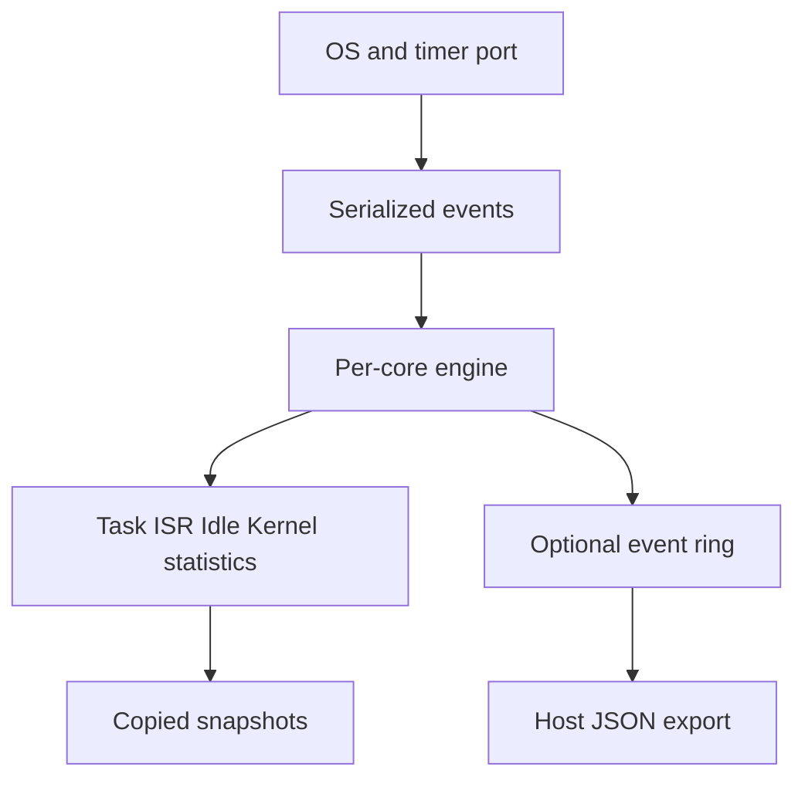

# embedded-runtime-observer

A small, caller-owned C99 engine for observing per-core Task, Idle, ISR, and function CPU time.
It runs without an RTOS, MCU SDK, heap, or tracing GUI. [中文](README_zh-CN.md)

An Idle interval interrupted by an ISR is not entirely idle. A task-switch timer can also straddle
a reporting boundary, while nested IRQ totals can accidentally count the same physical time twice.
This library makes those ownership rules explicit: a per-core execution stack, exclusive CPU
categories, and fixed-window accounting driven by periodic polls as well as transitions.



## Run in a minute

Requires a C99 compiler, GNU Make, Python 3, and pthreads for the concurrency test (Linux/Unix host).
The MCU core itself has no pthread/POSIX dependency.

```sh
git clone https://github.com/binkyle/autosar-module-lab.git
cd autosar-module-lab/embedded-runtime-observer
make test
./build/benchmark
```

`basic` prints `Task=20 Idle=70 ISR=10 Total=100 Load=30.0%`.
The suite passes **37 contract scenarios**, **4 Python tool tests**, 100,000 randomized transitions
against an independent tick oracle, two simulated cores with two concurrent snapshot readers,
and five runnable examples. See [validation details](docs/validation.md).

An equivalent CMake configuration is provided for CI and development:

```sh
cmake -S . -B build-cmake -DRTM_SANITIZE=ON
cmake --build build-cmake --parallel
ctest --test-dir build-cmake --output-on-failure
```

## Smallest example

```c
#include "rtm/rtm.h"
static rtm_core_t core;
rtm_config_t config = {100, 100, 0, 32, 1}; /* ticks; core; bits; mock coverage */
rtm_snapshot_t result;

/* Check every status in an actual integration. This single-thread mock has
   no concurrent writers. Target code uses a critical-section port. */
rtm_init(&core, &config, 0, RTM_IDLE);
rtm_isr_enter(&core, 20, 0);
rtm_isr_exit(&core, 30, 0);
rtm_snapshot(&core, 100, &result); /* exact 100-tick boundary, still in Idle */
/* result.last_window: Idle=90, ISR=10, CPU Load=10%. */
```

## What the numbers mean

`Total = Idle + Task + ISR + Kernel`, and `Busy = Total - Idle`. IRQ exclusive time excludes
nested IRQs; inclusive time includes them. Function points report same-owner CPU time, excluding
preemption/blocking. Their totals overlap CPU categories. Counts/min/max/averages are for completed
dispatch intervals or invocations, not inferred task activations. Snapshots also include open
execution time. See [contracts](docs/architecture/contracts.md) before using hardware results.

Every access to one object must be serialized, including snapshot and trace reads. The port wrapper
masks writers **before** reading time. All windows require polling within `max_gap_ticks`, which is
below timer half-range and no longer than a window. Missing whole wraps cannot be inferred from a
low-counter sample. A 64-bit window can span multiple low-32 wraps when sampling is timely.

## Scope and footprint

| Capability | v0.1.0 |
|---|---|
| Portable online engine, nested IRQs/functions, fixed windows | Host verified |
| Same-object concurrent access | Caller serialization; mutex simulation tested with ThreadSanitizer |
| Bare metal and AUTOSAR | Explicit interfaces and runnable mocks |
| TC397 / MICROSAR / TASKING | **Experimental / Unverified**; no vendor build/hardware results |
| Trace | Optional bounded FIFO; explicit drops; Host CSV→Perfetto instant-event JSON |
| CTF / BTF / globally synchronized multicore snapshots | Not implemented |
| Task migration, inferred activations, automatic WCET certification | Not implemented |

Default host layout: **11,144 bytes/core**, 3,648 bytes/snapshot. Reducing Tasks/ISRs/Points to 8,
depth to 4, and Trace to 0 gives **3,504 bytes/core**. Configure the same macros in every translation
unit. No hook allocates, blocks, transports, or prints; cost is bounded by compiled nesting limits.
Host sizes/timings do not establish TC397 RAM/ROM/WCET. Incomplete ISR coverage produces an observed
load estimate, even if the accounting equation holds perfectly.

## Port and explore

- [Integration contracts](ports/README.md), [AUTOSAR/TC397 case](docs/cases/tc397-autosar-runtime-measurement-study.md)
- [Architecture](docs/architecture/contracts.md), [official framework comparison](docs/research/open-source-framework-review.md)
- [Trace export](tools/trace_to_json.py), [read-only local evidence collector](tools/collect_case_evidence.py)
- [Contributing](CONTRIBUTING.md), [MIT license](LICENSE)

This is an online measurement core, complementary to full RTOS trace recorders and Host tools.
Use a mature recorder if its existing port and GUI meet your needs; no third-party implementation
is bundled here. Source: [autosar-module-lab/embedded-runtime-observer](https://github.com/binkyle/autosar-module-lab/tree/main/embedded-runtime-observer).
See [release status](docs/release-status.md) for module distribution and the standalone CI template.
Read the [Runtime Measurement series](https://binkyle.github.io/blog/Autosar/RuntimeMeasurement/) for the time model, design, and AUTOSAR integration walkthrough.
