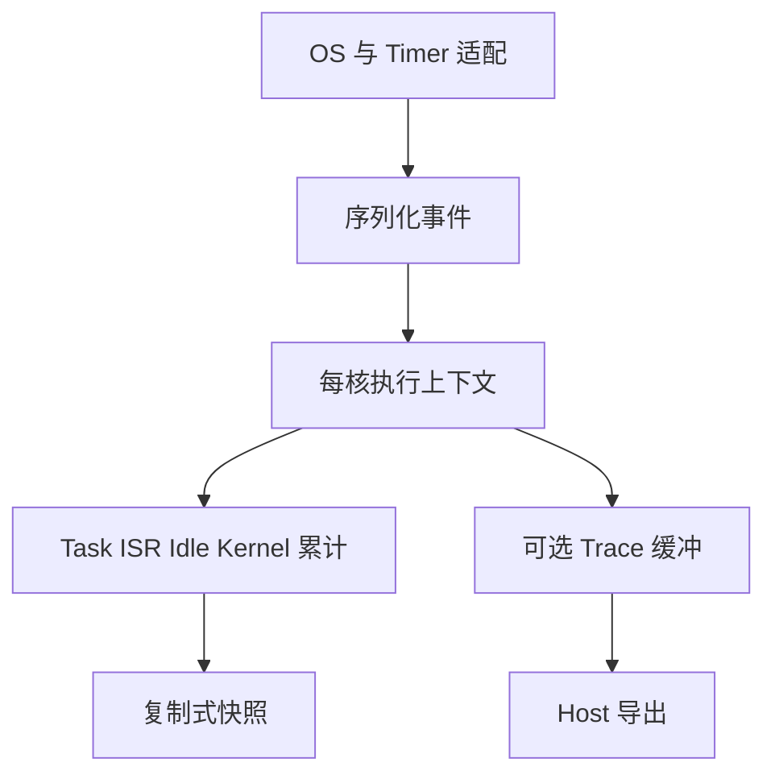

# embedded-runtime-observer

一个不依赖 MCU SDK、RTOS 或堆内存的 C99 运行时测量核心，统计每核 Task、Idle、ISR 和函数的 CPU 执行时间。[English](README.md)

它解决三个容易混淆的问题：中断抢占 Idle 后的时间归属、嵌套 ISR 的重复累计，以及没有任务切换时的窗口结算。通过明确执行上下文、每核状态栈和周期 poll，保证完整模拟事件流中 `Total = Idle + Task + ISR + Kernel`。

源码位于 [autosar-module-lab/embedded-runtime-observer](https://github.com/binkyle/autosar-module-lab/tree/main/embedded-runtime-observer)，作为独立模块与仓库内其他模块并列。

## 快速运行

Linux/Unix 下需要 C99 编译器、GNU Make、Python 3；并发测试另需 pthread。核心源码没有 POSIX 依赖。

```sh
git clone https://github.com/binkyle/autosar-module-lab.git
cd autosar-module-lab/embedded-runtime-observer
make test
./build/benchmark
```

基础示例的实际输出：

```text
Task=20 Idle=70 ISR=10 Total=100 Load=30.0%
```

已通过 37 个核心场景、4 个 Python 工具测试、10 万次随机转换的独立逐 tick 核验、双核/双读者共 20 万次并发序列化操作，以及 5 个示例。地址/未定义行为检查、ThreadSanitizer 和 GCC 静态分析结果见[验证文档](docs/validation.md)。

## 架构与接入



最小调用：

```c
static rtm_core_t core;
rtm_config_t cfg = {100, 100, 0, 32, 1};
rtm_snapshot_t s;
/* 单线程 Mock 示例；真实接入检查所有返回值并保护每次访问。 */
rtm_init(&core, &cfg, 0, RTM_IDLE);
rtm_isr_enter(&core, 20, 0);
rtm_isr_exit(&core, 30, 0);
rtm_snapshot(&core, 100, &s); /* Idle=90、ISR=10，负载 10% */
```

硬件使用 `port.h`：先屏蔽所有本核写者，再读取时间戳，更新状态，恢复原屏蔽状态。远程核读取拥有者复制出的快照，不读取正在被修改的活跃对象。64 位累计不是 64 位原子访问保证。

窗口可以长达 60 秒，但低 32 位计时仍需及时 poll。`max_gap` 必须小于半回绕范围且不长于窗口，完整回绕后的混叠无法仅凭两个低位样本检测。ISR 嵌套使用 LIFO；结束不匹配、深度/计数溢出会使测量 epoch 无效，需要在已知执行状态下 reset。

Task 次数表示完成的 dispatch 区间；ISR/函数次数表示完整调用对。min/max/average 不包含未结束调用，累计执行时间则包含已采样的活跃部分。函数测的是所属上下文的 CPU 时间，不是含阻塞和抢占的 wall latency。详见[统计契约](docs/architecture/contracts.md)。

## 当前范围

通用核心、Mock Timer、Task/Idle/ISR、嵌套函数、固定窗口、多核独立模拟、Trace 关闭模式和测试已经实现。默认 Host 布局每核 11,144 字节；缩小容量并关闭 Trace 后为 3,504 字节。结构体大小与性能需在目标 ABI 上重测。

AUTOSAR 和裸机提供可运行的独立模型；TC397 STM 低位寄存器策略有 Host 编译示例，真实 MICROSAR/TASKING/TC397 接入标记为 **Experimental / Unverified**。没有业务源码审查或实车测试结果。CTF/BTF、多核同步全局快照、任务跨核迁移暂未实现。Trace JSON 是 Host 即时事件格式，不冒称 CTF/BTF。

阅读[开源方案取舍](docs/research/open-source-framework-review.md)、[TC397 案例与取证脚本](docs/cases/tc397-autosar-runtime-measurement-study.md)、[移植契约](ports/README.md)、[贡献说明](CONTRIBUTING.md)和[发布状态](docs/release-status.md)。项目采用 MIT 许可，公开代码独立编写。

配套阅读：[嵌入式运行时测量专题](https://binkyle.github.io/blog/Autosar/RuntimeMeasurement/)。
