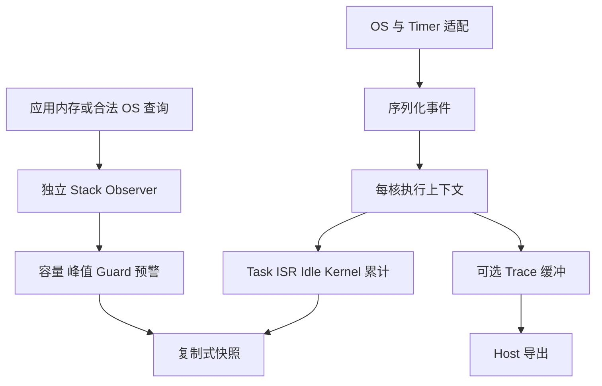

# embedded-runtime-observer

一个不依赖 MCU SDK、RTOS 或堆内存的 C99 资源观测模块，统计每核 Task、Idle、ISR 和函数执行时间，以及栈容量与历史峰值。[English](README.md)

时间核心通过明确执行上下文、每核状态栈和周期 poll，建立 `Total = Idle + Task + ISR + Kernel` 的时间账本。v0.2.0 增加独立 Stack Observer，提供有效容量、水位峰值、剩余裕度、预警和可选边界检查。

源码位于 [autosar-module-lab/embedded-runtime-observer](https://github.com/binkyle/autosar-module-lab/tree/main/embedded-runtime-observer)，作为独立模块与仓库内其他模块并列。

## 快速运行

Linux/Unix 下需要 C99 编译器、GNU Make、Python 3；并发测试另需 pthread。核心源码没有 POSIX 依赖。

```sh
git clone https://github.com/binkyle/autosar-module-lab.git
cd autosar-module-lab/embedded-runtime-observer
make test
./build/benchmark
./build/stack_simulator
```

基础示例的实际输出：

```text
Task=20 Idle=70 ISR=10 Total=100 Load=30.0%
```

原有 37 个时间场景、4 个 Python 工具测试、10 万次随机转换、20 万次并发序列化操作和 5 个示例均通过回归。新增 39 个栈契约场景、8,000 次字节 oracle 核验、20 万次并发操作和 2 个示例。详见[时间验证](docs/validation.md)与[栈验证](docs/validation/stack-validation.md)。

```sh
make stack-test                 # 单独构建运行栈示例与测试
make stack-benchmark            # 1/2/8/16 KiB 扫描基准
make RTM_BUILD_STACK=0 test      # 仅原有时间核心
cmake -S . -B build-stack -DRTM_BUILD_RUNTIME=OFF
cmake --build build-stack --parallel
ctest --test-dir build-stack --output-on-failure
```

仅构建目标库时增加 `-DBUILD_TESTING=OFF -DRTM_BUILD_EXAMPLES=OFF`。`rtm_stack` 不依赖时间核心、Trace、TriCore 或 pthread/POSIX。

## 架构与接入



最小调用：

```c
static rtm_core_t core;
rtm_config_t cfg = {100, 100, 0, 32, 1};
rtm_snapshot_t s;
/* 单线程 Mock 示例；真实接入检查所有返回值并保护每次访问。 */
rtm_init(&core, &cfg, 0, RTM_IDLE);
rtm_isr_enter(&core, 20, 0);
rtm_isr_exit(&core, 30, 0);
rtm_snapshot(&core, 100, &s); /* Idle=90、ISR=10，负载 10% */
```

硬件使用 `port.h`：先屏蔽所有本核写者，再读取时间戳，更新状态，恢复原屏蔽状态。远程核读取拥有者复制出的快照，不读取正在被修改的活跃对象。64 位累计不是 64 位原子访问保证。

窗口可以长达 60 秒，但低 32 位计时仍需及时 poll。`max_gap` 必须小于半回绕范围且不长于窗口，完整回绕后的混叠无法仅凭两个低位样本检测。ISR 嵌套使用 LIFO；结束不匹配、深度/计数溢出会使测量 epoch 无效，需要在已知执行状态下 reset。

Task 次数表示完成的 dispatch 区间；ISR/函数次数表示完整调用对。min/max/average 不包含未结束调用，累计执行时间则包含已采样的活跃部分。函数测的是所属上下文的 CPU 时间，不是含阻塞和抢占的 wall latency。详见[统计契约](docs/architecture/contracts.md)。

## 当前范围

### Stack Measurement

`rtm_stack_t` 由调用者静态分配，一对象对应一块物理栈区域。应用拥有的离线内存允许 painting；OS-managed 区域只经合法查询回调读取，不保留栈指针、不扫描或填充 OS 内存。没有合法查询时返回 Unsupported。

```c
#include "rtm/stack.h"
#include <string.h>
static unsigned char memory[2052]; /* 虚拟字节数组，不是当前执行栈。 */
static rtm_stack_t observer;
rtm_stack_region_t cfg = {0};
rtm_stack_usage_t s;
cfg.memory = memory;
cfg.region_bytes = sizeof(memory);
cfg.cell_bytes = cfg.guard_bytes = 4;
memset(cfg.fill_pattern, 0xaa, sizeof(cfg.fill_pattern));
memset(cfg.guard_pattern, 0xde, sizeof(cfg.guard_pattern));
if (rtm_stack_init(&observer, &cfg) != RTM_STACK_OK) return 1;
if (rtm_stack_paint(&observer) != RTM_STACK_OK) return 2;
memset(memory + 4 + 2048 - 640, 0x55, 640);
if (rtm_stack_measure(&observer, &s) != RTM_STACK_OK) return 3;
/* Capacity=2048 B，Peak=640 B，Remaining=1408 B，Usage=31.25%。 */
```

有效容量扣除两端保留区及 Guard，支持向低/高地址增长和 1/2/4/8 B 单元。字节访问兼容未对齐存储。扫描从最深端顺序寻找首个变化单元，成本取决于未改变区域的长度；`snapshot` 只复制上次结果。

Peak 是同一 epoch 内已观察水位的最大值，`current_status` 明确为 Unsupported。图案碰撞或只调整 SP 而未写入的空间可能低估真实深度。Guard 提供边界变化证据，不预防溢出。所有对象访问和内存写入由调用者串行化，测量期间源内存必须静止。

OS adapter 归一化历史已用字节或最小剩余 word，共享 ISR 映射到同一物理区域。核访问权限、初始化和允许的调用上下文由工程包装层落实；扫描与可能阻塞的跨核查询安排在合适的报告任务中。

参阅[API 与使用指南](docs/stack-observer.md)、[架构决策](docs/architecture/stack-observer.md)、[AUTOSAR 栈案例](docs/cases/tc397-autosar-stack-study.md)和[示例目录](examples/README.md)。

### 时间核心与平台

通用核心、Mock Timer、Task/Idle/ISR、嵌套函数、固定窗口、多核独立模拟、Trace 关闭模式和测试已经实现。默认 Host 布局每核 11,144 字节；缩小容量并关闭 Trace 后为 3,504 字节。结构体大小与性能需在目标 ABI 上重测。

AUTOSAR 和裸机提供可运行的独立模型；TC397 STM 低位寄存器策略有 Host 编译示例，真实 MICROSAR/TASKING/TC397 接入标记为 **Experimental / Unverified**。没有业务源码审查或实车测试结果。CTF/BTF、多核同步全局快照、任务跨核迁移暂未实现。Trace JSON 是 Host 即时事件格式，不冒称 CTF/BTF。

阅读[开源方案取舍](docs/research/open-source-framework-review.md)、[TC397 案例与取证脚本](docs/cases/tc397-autosar-runtime-measurement-study.md)、[移植契约](ports/README.md)、[贡献说明](CONTRIBUTING.md)和[发布状态](docs/release-status.md)。项目采用 MIT 许可，公开代码独立编写。

[文档索引](docs/README.md)汇总时间与内存资源的接口、验证和[后续路线](docs/roadmap.md)。仓库根目录已增加[模块 CI](https://github.com/binkyle/autosar-module-lab/actions/workflows/embedded-runtime-observer.yml)，覆盖 GCC/Clang、Trace 0/64、Stack 开关与独立栈构建。

配套阅读：[嵌入式运行时测量专题](https://binkyle.github.io/blog/Autosar/RuntimeMeasurement/)。
