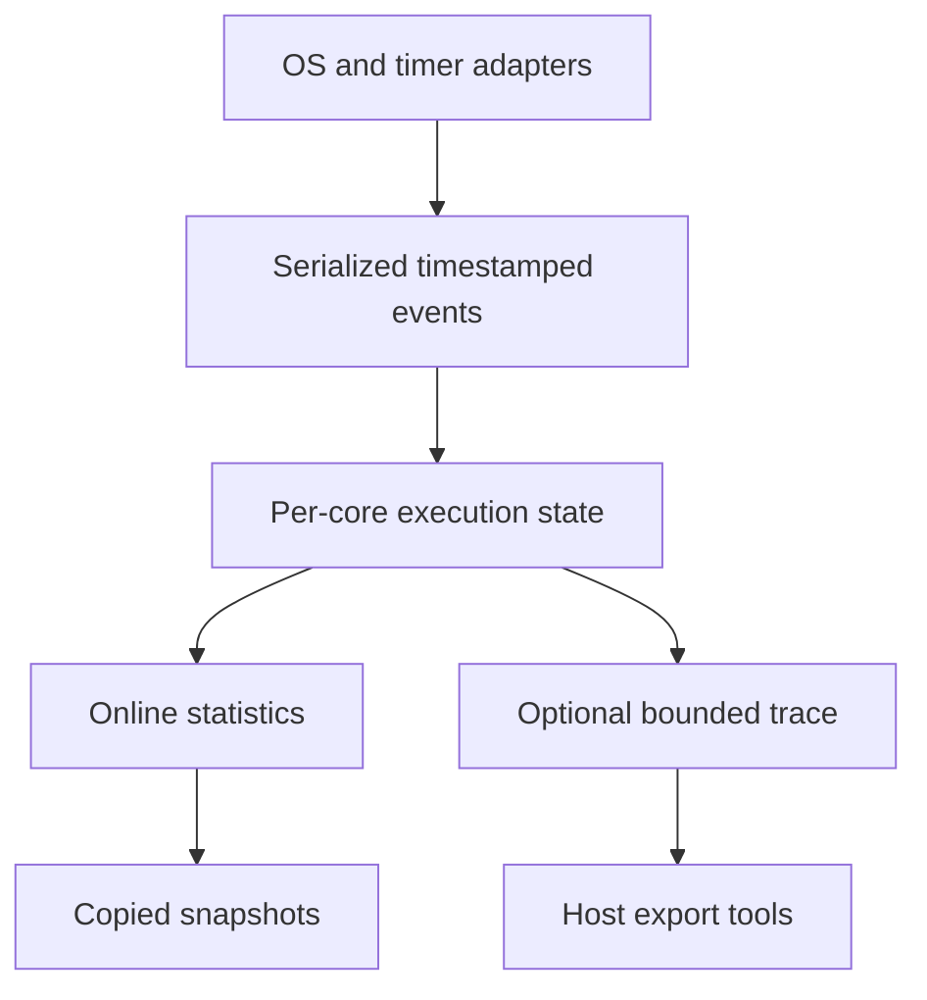

# Architecture and measurement contracts

Status: v0.1.0, host-verified C99. TC397 / MICROSAR integration is **Experimental / Unverified**.

## 1. A small event engine

The core receives timestamped execution transitions. It does not read a timer, choose an OS task,
mask interrupts, or transport trace packets. Caller-owned `rtm_core_t` objects isolate each core.
`port.h` supplies a convenience wrapper that acquires a platform critical section, reads the clock,
updates the engine, and restores the previous interrupt mask. No core API allocates memory, waits,
prints, or invokes a user callback. Floating-point load/average helpers are for reporting, outside hooks.

Statistics and trace share an event boundary but have independent lifetimes. Dropping a trace record
does not change the online counters. `RTM_TRACE_CAPACITY=0` removes the buffer and event writes.
The public structures are a source-level interface, not a stable binary/wire ABI.

## 2. Mutually exclusive CPU categories

At every accepted interval exactly one category runs:

`Total = Idle + Task + ISR + Kernel`

`Busy = Total - Idle`, so `CPU Load = 100 × Busy / Total`.

Idle is an explicit sentinel, not an inferred priority or the absence of events. Kernel is another
sentinel representing an instrumented scheduling gap. Hooks, entry/exit assembly, uncovered ISR
prologues, and measurement overhead remain attributed to the category active at the chosen timestamp
boundary. The library cannot separately identify these costs without additional events. `Kernel`
is therefore an observed gap, not all OS execution. Point time overlaps Task/ISR time and is never
added to CPU Busy. ISR inclusive totals overlap nesting and must not be summed to obtain CPU time.

`complete_coverage=1` is the adapter author's declaration that all relevant execution transitions are
observed. `valid=1` means events satisfy library contracts; neither flag calibrates timer accuracy.
An incomplete adapter can preserve the equation above while still assigning hardware work to Idle.

## 3. Execution state

The current Task/Idle/Kernel owner is suspended beneath an ISR invocation stack. Enter pushes an ISR;
exit must match the top ID, then restores the suspended owner. Switches during ISR are rejected.
For an ISR that wakes a different task, emit exit first, then a switch at the actual dispatch boundary.

| Transition | Accounting before changing state | New owner |
|---|---|---|
| Task/Idle/Kernel → Task/Idle/Kernel | Close the old owner's elapsed interval | New task sentinel/ID |
| Task/Idle/Kernel → ISR | Charge old owner up to entry | New ISR frame |
| ISR A → ISR B | A exclusive interval ends; inclusive remains open | B frame |
| ISR B → ISR A | Close B invocation; A resumes exclusive accounting | A frame |
| Outermost ISR → suspended owner | Close ISR invocation | Previous Task/Idle/Kernel |
| Periodic poll or snapshot | Extend current owner up to now | Owner unchanged |

Example: A enters at 10, B at 20, B exits at 30, A exits at 50. A inclusive=40,
A exclusive=30, B inclusive=exclusive=10. Aggregate physical ISR time=40, not 50.
Reentrant same-ID ISR frames are separate invocations and aggregate into the same metric.

## 4. What counts mean

`exclusive_ticks` includes accepted time from both finished and currently open intervals.
ISR/point `inclusive_ticks` includes descendants in the same measurement hierarchy. Task inclusive
and exclusive are equal in this version; neither includes interrupt time.

`task[id].completed` counts ended dispatch intervals when switching away from that Task ID.
A dispatch interval can contain IRQ pauses. A switch to the same ID is a no-op; it is not a new
activation. Pre/Post hook mapping through Kernel naturally produces more dispatch intervals.
ISR and point `completed` count matched invocation pairs. Activation and Runnable counts are not
inferred from task switches. Instrument their actual entry/exit with distinct point IDs when needed.

Min/max and averages describe **completed** intervals only. Average uses
`completed_exclusive_ticks / completed`, not the inclusive total or an open interval. Zero completed
samples give average 0; distinguish this from a completed zero-duration sample by checking the count.
Task utilization is `100 × task[id].exclusive_ticks / lifetime.total_ticks` over the same lifetime.

## 5. Function points and ownership

Every Task, Idle, Kernel, and ISR invocation has its own LIFO point stack. Begin/end accept recursive
same-ID calls; a repeated begin pushes another invocation. A task stack survives another task's
dispatch and IRQ preemption. ISR stacks disappear only when their points have all ended.

Point inclusive time is CPU time while its owner executes, including nested function points.
Exclusive time omits nested points. Both exclude other Tasks, IRQs preempting that owner, and blocked
time. These metrics are not wall latency. A point cannot end on a different task, core, or ISR owner.
Tasks must be pinned to their observer core in this version; task migration is not implemented.

Unmatched end, wrong LIFO ID, depth overflow, or an ISR exit with open points produces a sticky fault.
An open Task point remains open until a matching end or reset; the core cannot infer a missing end
without a task lifecycle event. Close all points before terminating/reusing a task. For hardware
errors it is safer to restart an observation epoch than to silently guess the missing execution state.

## 6. Clock, rollover, and windows

Input timestamps are the low `counter_bits` bits of a monotonically advancing counter (2–32 bits).
Interval calculation uses modular unsigned subtraction. Set `max_gap_ticks` strictly below the
counter's half range, and call an event/poll/snapshot within that actual elapsed gap. Larger visible
gaps and apparent backward time fault. **An entire wrap followed by a short remainder can alias a
valid delta**; software cannot detect it from two low-counter samples. The port must enforce polling
or use an external continuity monitor. Debug halts, clock stoppage, DVFS, and reset require rebase.

Window length is 64-bit, so a 60-second window at 100 MHz (6,000,000,000 ticks) is supported even
with a low-32-bit counter. For that example, poll much faster than 21.47 seconds; a 1-second poll
is an illustrative setting, not a measured target configuration.

Accepted `max_gap_ticks <= window_ticks` bounds each call to at most two accounting chunks and one
window closure. A snapshot/poll splits an active Task, Idle, ISR, and open points at the exact logical
boundary without ending their invocations. A periodic sampling source is required; the engine does
not install a timer interrupt. An observed event cannot describe an unobserved transition between
samples. Windows are half-open `[begin, begin + length)`; events exactly at a boundary affect the next.

The current partial window and latest completed window are retained; earlier completed windows are
not queued. Save every returned window in an owner-core reporting path when a complete history is
needed. `windows_completed`/`last_window.number` expose skipped results to a consumer. Polling after a
long interval that violates `max_gap` fails rather than running an unbounded catch-up loop.

All statistics use checked 64-bit additions. Overflow saturates the affected counter and faults the
epoch; no valid reading is claimed thereafter. Reset preserves config and discards ALL totals,
frames, trace records, and open invocations. Supply a known new initial owner and timer reading.

## 7. Concurrency contract

All APIs on one object, including trace pop and snapshot copy, must be serialized. On an MCU, only
its owner core accesses the object and local critical sections mask **every** possible writer.
Save/restore the prior mask; never unconditionally enable interrupts at exit. Cat1 and NMI writers
need an explicitly supported scheme or must be excluded with incomplete coverage. A Cat2-only
interrupt mask is insufficient if Cat1 also updates the object.

Read the timestamp after acquiring serialization. A timestamp sampled before a higher-priority
writer runs can arrive out of order despite subsequent locking. Snapshot copy occurs under the
same protection, making 64-bit counters safe even on a 32-bit machine. It is bounded by configured
capacity, but measure its masking cost before using it in a high-priority ISR.

On a host, tests use one pthread mutex per core. That is a simulation strategy, not an ISR port.
Different objects have no shared mutable global state and can advance concurrently. For a remote
core reporter, request an owner-core copy and publish it through IOC/message passing with a proper
memory/cache protocol. Reading another core's live object with `volatile`, NonCached RAM, or an
unsynchronized C99 seqlock is not supported. Separate per-core epochs/windows do not establish a
simultaneous global snapshot. Synchronize timers and epochs independently if that is required.

## 8. Cost and trace output

Accounting cost is O(ISR depth + current point depth), with static maxima. Switch/trace operations
have fixed bounded storage work; snapshot/reset cost scales with compiled capacities. Default host
layout: 11,144 bytes/core; 3,504 bytes with Tasks/ISRs/Points=8, depth=4, Trace=0. These x86-64 layouts
are not guaranteed target ABI sizes. No target WCET, OS certification, or production integration is claimed.

Trace uses a caller-serialized FIFO ring, dropping **new** events when full. Sequence numbers advance
for attempted records and `trace_dropped` reports loss. A full ring does not change counters. Export
fields explicitly; do not serialize raw C structs because padding and endianness differ.
`trace_to_json.py` produces Chrome/Perfetto instant-event JSON with per-core independent epochs.
It detects visible sequence gaps, not trailing drops after the last available record; also report
`trace_dropped`. It does not reconstruct spans or synchronize clocks. CTF export can later use a
generated barectf encoder/Host converter; BTF is a separate format, not an alias of CTF or JSON.
